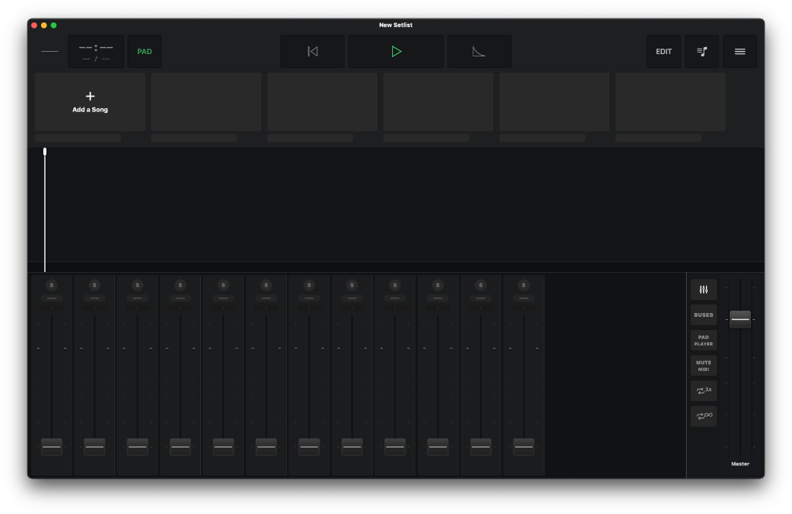

# PeanutButter

### A free, open-source macOS multitrack workstation for live worship and stage performance.


PeanutButter is a native macOS multitrack playback app licensed under `GPL-3.0`. It includes multi-channel audio routing, 16 sub-mix buses, 8 MIDI automation buses, ProPresenter triggers, SMPTE LTC timecode, formant-preserving key and tempo shifting, a wireless browser remote, optional team cloud sync, and offline rehearsal mix bouncing.

While PeanutButter was designed with churches and worship teams in mind, it works just as well for touring acts, cover bands, theater pits, and solo artists who want reliable backing tracks, clicks, spoken cues, and MIDI/timecode automation without DAW complexity or monthly fees. There are no account logins, per-seat cloud fees, or paid tiers.

<p align="center">
  
  <br />
  <em>PeanutButter Home Screen, ready to build or load a setlist.</em>
</p>

---

## Core Features

### Free, Open Source, and Unlocked
Every feature ships unlocked under the GNU General Public License v3.0 (`GPL-3.0`). Whether you run a single laptop or a multi-output FOH/IEM rig, there are no subscription checks or gated features.

### Local-First Storage and Bring Your Own Cloud (BYOC)
- Your songs (`.pbsong`) and setlists (`.pbsession`) stay on your Mac with no internet connection or sign-in required.
- To share a library with your team, point PeanutButter at a folder in iCloud Drive, Google Drive, Dropbox, or OneDrive.
- Audio stems are bundled into `<songId>.pbstems` packs for reliable cloud transfers. When opening Cloud setlists, PeanutButter keeps Cloud song settings while automatically reusing matching local stems already on your Mac to save download time.
- Setlist rows display **Local**, **Cloud**, or **Unsaved** location badges, with **Move to Cloud**, **Duplicate to Local**, and **Delete All Cloud Setlists From Device** actions (removing only downloaded Cloud setlists and cached Cloud stems while leaving all local files untouched). Saving prompts for optional release notes, and teammate Macs show a cyan Update badge with a preview of what changed before downloading.

### Your Own Stems, Pads, Click Sounds, and Guide Voices
PeanutButter does not lock your audio library into a closed store.
- Load `.wav`, `.m4a`, `.mp3`, `.aiff`, or `.flac` stems from any source, or use **Import Song From Folder...** (and main-window drag-and-drop) to load stems, default cover artwork, and parsed title, key, and BPM from a folder automatically. `Auto-Sort Stems` and role detection organize stems into your mix buses automatically.
- The app ships with two stock 12-key pads (`Simple` and `Soft`) and lets you import any 12-key custom pad folder. Imported pads are RMS loudness-normalized so switching pad packs keeps stage volume consistent.
- Seven synthesized click engines (*Classic*, *Woodblock*, *Beep / Synth*, *Sticks / Rimshot*, *Cowbell*, *Shaker*, *Tambourine*) are built in, or you can upload your own Accent, 1/4, 1/8, and 1/16 samples.
- Seven bundled human guide voice packs (**Sam**, **Caleb**, **Claire**, **Daniel**, **Hannah**, **Marcus**, and **Maya**) are included. You can upload your own recorded voice packs, enable optional **Local AI Voice Cloning** (on-device CoreML LuxTTS on Apple Silicon, ~348 MB download) so custom cues and announcements speak in your active guide voice, and keep macOS system/Siri TTS as backup.

### Faster-Than-Real-Time Rehearsal and Practice Tracks
Skip recording real-time reference tracks in an external DAW.
- Export an entire setlist run-through as MP3 (built-in native `libmp3lame` 256 kbps, no external `lame` or `ffmpeg` install required), M4A, or WAV in seconds, with independent Include Click Track and Include Guide Track toggles and automatic 5-second gaps after manual-stop songs.
- Batch-export part-dominant practice mixes (`[Song] - [Instrument] - Key of [Key]`) for Electric Guitars (All), Bass, Drums, Acoustic, Piano, and Vocals. Click/Guide and the player's instrument stay at `0 dB`, core instruments sit at `-10 dB`, and background beds sit at `-20 dB`.

### Wireless Stage Remote (`PeanutButter Remote`)
Turn on the built-in local Wi-Fi server (`_peanutbutter._tcp` via Bonjour, with an optional passcode lock) so MDs, worship leaders, or FOH can open a web controller in any phone, iPad, or laptop browser:
- Play/Pause, Return to Zero, Fade Out, and Tap Tempo
- Click sections to cue quantized amber jumps while playing
- Switch setlist songs, toggle or link the Ambient Pad Player, and adjust mixer faders, mutes, and solos live

### MultiTracks Playback Migration
Use the built-in 4-step **Import from Playback...** wizard to read your local MultiTracks Playback database and migrate setlists, saved arrangements, section trims, keys, tempos, mixes, MIDI cues, ProPresenter triggers, and automation. The importer matches your unprotected `.wav` or `.m4a` stem folders on disk. Encrypted `.pmt` store stems are never decrypted or imported.

### Performance and Reliability
- On-device Rubber Band R3 processing pre-renders key and BPM changes to a disk cache, and mastering-quality offline sample rate conversion (`44.1` through `192 kHz`) keeps mixed-rate stems, guides, pads, and exports phase-clean and beat-locked.
- Your active setlist loads into RAM for zero-latency song switching, with automatic macOS memory-pressure safeguards on lower-RAM Macs.
- `CADisplayLink` metering and GPU-cached waveforms keep scrolling and live fader drags smooth.

---

## Everyday Workflow Features

- Undo and redo (`Cmd+Z` / `Shift+Cmd+Z`) across arrangement edits, section trims, cue moves, MIDI/keyboard mappings, tempo/key changes, and mixer faders, mutes, solos, pans, and routing.
- Drop preset spoken directional cues (*Build, Breakdown, All In, Band Out, Hits, Hold, A Cappella*, etc.) or type any custom phrase to hear it spoken in time, even over an uploaded guide stem.
- Drag MIDI, Directional, Automation, and SMPTE cues on the waveform with beat-grid snapping, or nudge them in `1/16`-note increments.
- Copy MIDI cues from one section (`Chorus 1`) and choose **Paste & Auto-Adjust Velocity** to continue sequential cue numbering (`N+1, N+2...` per bus for ProPresenter lyric slides) or **Paste Original Velocities**.
- Drop `2/4`, `3/4`, `5/4`, `6/8`, `7/8`, `9/8`, `12/8`, or custom time signature changes onto any bar in **Song Sections** without splitting audio. Click accents, beat grid lines, measure numbers, and live transport badges update automatically.
- Add stemless **Click & Pad** items directly to a setlist, or insert **Blank Click Sections** and **Section-Mirrored Click Sections** (stems muted, Click, Guide, and Pad active) mid-song in two clicks.
- Drag section handles to trim bars, reorder or repeat sections in **Setlist / Song Map**, and save multiple named arrangements per song without modifying audio files.
- On Overlap/Crossfade transitions, outgoing Click and Guide automatically mute on the overlap downbeat so two clicks and two voices never collide.
- Enable **Announce Song** per song (with a **Preview** button in the Song Menu) to speak the song title (skipping standalone `(Live)` tags automatically) and current transposed key right before the count-in, or inside the previous song's end section ahead of AutoLink, Overlap, and Crossfade transitions.
- Clear a song's MIDI automation cleanly with **Delete All MIDI Cues** (`Edit > MIDI Cues` menu, scoped strictly to the current song), while saved audio interface selections, bus routing, and stage signal channels persist reliably across app updates.
- Drop raw stems into **Song Builder**, detect BPM automatically, and let `GuideSectionDetector` analyze your guide track to place `Intro`, `Verse`, `Chorus`, and `Bridge` markers.
- Click any transport button, section control, fader, mute, or solo to map MIDI notes/CCs or Mac keyboard keys, with conflict reassignment prompts and **Reset to Defaults**.
- Send `F-1` / `F#-1` ProPresenter playlist and item triggers on song start, broadcast 24 PPQN MIDI Beat Clock per destination, output SMPTE LTC timecode (`24` to `30` fps), and run a continuous 1 kHz Redundancy pilot tone on any free mono output.

---

## Documentation

- Read the **[Full Feature Guide](FEATURE_GUIDE.md)** for step-by-step explanations of every feature in PeanutButter.
- Check **[Releases](https://github.com/rghapro/PeanutButter/releases/latest)** for prebuilt downloads or report bugs and requests on **[Issues](https://github.com/rghapro/PeanutButter/issues)**.

---

## Download

Download the latest signed and notarized Universal macOS installer (`PeanutButter.dmg`) from **[Releases](https://github.com/rghapro/PeanutButter/releases/latest)**, open it, and drag **PeanutButter.app** into **Applications**.

---

## Quick Start (Build from Source)

### Requirements
- macOS 14.0+ (Sonoma or newer, Apple Silicon or Intel)
- Swift 5.10+ (Xcode 15.3+ or Apple Command Line Tools)

### Build & Run
```bash
git clone https://github.com/rghapro/PeanutButter.git
cd PeanutButter
./build.sh
open "PeanutButter.app"
```

Or compile via Swift Package Manager directly:
```bash
swift build -c release
```

---

## Audio Assets and Third-Party Libraries

- Bundled royalty-free 12-key pads (`Simple`, `Soft`), 7 human guide voice packs, and 7 synthesized click engines work out of the box. Third-party commercial samples are excluded via `.gitignore`.
- **Rubber Band Library (`Sources/CRubberBand`):** Used for pitch shifting and time stretching under GPLv2+ (`Sources/CRubberBand/vendor/COPYING`).
- **LAME (`Sources/CLame`, [LAME-COPYING](ThirdPartyLicenses/LAME-COPYING)):** Embedded LGPL-2.0+ MP3 encoder for native zero-dependency 256 kbps MP3 export.
- **LuxTTS CoreML & English G2P (`Sources/PeanutButter/Engine/VoiceClone`, [LuxTTS-LICENSE.md](ThirdPartyLicenses/LuxTTS-LICENSE.md)):** Optional on-device Apple Silicon voice cloning downloads the compiled CoreML model bundle on demand without bundling large weights inside the app.

---

## License

PeanutButter is free, open-source software licensed under the GNU General Public License v3.0 (`GPL-3.0`). See [LICENSE](LICENSE) for full details.
